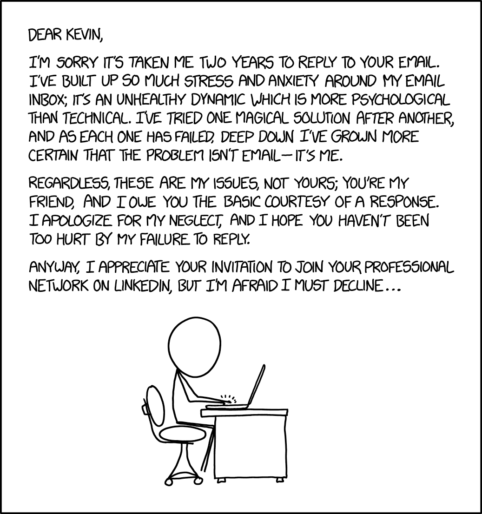

## Due dates

| What | When | Points |
|---|---|---|
| [Homework in LaTeX](../assignments/deliverables/latex-homework.qmd) &mdash; `Lastname-Firstname-LaTeX.pdf` and `.tex` | **Tonight**, Oct. 16, 11:59 PM ET | 50 (5%) &middot; Academic Planning |
| [Online Profile](../assignments/deliverables/online-profile.qmd) | Oct. 23, 11:59 PM ET | 75 (7.5%) &middot; Career Readiness |
| [Advising Meeting & Spring 2027 Plan](../assignments/deliverables/advising-spring-plan.qmd) | Oct. 30, 11:59 PM ET | 60 (6%) &middot; Academic Planning |
| [Team Project Slides](../assignments/deliverables/team-project-slides.qmd) and Presentation | Slides Nov. 6; talk Nov. 6 or Nov. 13 | 100 + 100 (20%) &middot; Team Project |

::: notes
We share today's period with the first Physics\@Tech talk, so keep this to about 15 minutes.
Team Leader check-ins for the Team Project are due Oct. 23, the same day as the Online Profile.
:::

---

{fig-align="center" height="680" fig-alt="xkcd comic: a stick figure at a laptop writes a long, anxious apology for taking two years to answer a friend's email, which ends by declining the friend's invitation to connect on LinkedIn."}

::: notes
Let them read it. The punchline: the two-year-old email was a LinkedIn invitation. The lesson for
today is the opposite: connect within a day, while the person still remembers you. Source:
[@xkcd1873], CC BY-NC 2.5.
:::

---

## Building your LinkedIn profile

:::: {.columns}
::: {.column width="58%"}
::: {.nonincremental style="font-size: 0.9em;"}
- **Photo:** clear, smiling, uncluttered background
- **Headline:** who you are and what interests you
- **Summary:** a short paragraph is fine
- **Education:** Georgia Tech and your major
- **Experience, projects, activities**
- **Skills** you actually have
- **Custom URL:** `linkedin.com/in/yourname`
:::
:::
::: {.column width="42%"}
::: {style="font-size: 0.7em; border: 1px solid #B3A369; padding: 0.4em 0.9em;"}
**Less effective headline**

Student at Georgia Institute of Technology
:::

::: {style="font-size: 0.7em; border: 1px solid #B3A369; padding: 0.4em 0.9em; margin-top: 0.5em;"}
**More effective headline**

Physics first-year at Georgia Tech &middot; Interested in quantum materials &middot; Python, Arduino
:::
:::
::::

::: {.cite-note}
Source: [@gt1000_linkedin]
:::

::: notes
As first-year students, they are not expected to have a long work history. Strong high school
projects, clubs, and volunteering count. The summary can borrow from the resume they submitted in
September. Skip buzzwords like "motivated" and "driven"; show those qualities through what they
have done. LinkedIn is the focus, but a GitHub profile, personal website, or ORCID iD is a good
addition for physics majors.
:::

---

## Connecting without being weird

:::: {.columns}
::: {.column width="55%"}
::: {.nonincremental}
- **Personalize every invitation:** where you met and why you're connecting.
- **Connect within a day** of meeting someone: a recruiter, a speaker, an alum.
- Join groups such as **Georgia Tech Alumni**.
- Put your profile URL on your **resume** and in your **email signature**.
:::
:::
::: {.column width="45%"}
::: {style="font-size: 0.7em; border: 1px solid #B3A369; padding: 0.4em 0.9em;"}
"Hi Dr. Lee, I'm a first-year Physics major in GT 1000. I enjoyed your Physics\@Tech talk today, especially the part on detector calibration. I'd like to keep up with your group's work."
:::

::: {.highlight-box}
Today's speaker is a good first connection. Send the request tonight.
:::
:::
::::

::: {.cite-note}
Source: [@gt1000_linkedin]
:::

::: notes
Swap in today's speaker's name and a real detail from the talk. Invitation notes are capped at a
few hundred characters, and LinkedIn limits how many personalized invitations free accounts can
send each month; re-check the current limits before class. A follow-up email works as well as a
LinkedIn request, and a thank-you note after any meeting is never wasted.
:::

---

## The Online Profile assignment

:::: {.columns}
::: {.column width="50%"}
**Submit one PDF to Canvas:**

::: {.nonincremental}
1. Your LinkedIn profile, saved with **Save to PDF**
2. Optional URLs: website, GitHub, portfolio
:::

**No LinkedIn?** Submit the other professional materials instead.
:::
::: {.column width="50%"}
**Save to PDF** (desktop browser):

::: {.nonincremental}
1. **Me &rarr; View Profile**
2. **More** (or **Resources**)
3. **Save to PDF**
:::
:::
::::

::: {.highlight-box}
[Online Profile](../assignments/deliverables/online-profile.qmd): due **Oct. 23, 11:59 PM ET** &middot; 75 points (7.5%) &middot; Career Readiness
:::

::: {.cite-note}
Source: [@linkedin_savepdf]
:::

::: notes
Save to PDF works only for profiles set to English; anyone who cannot use it should contact me for
another way to document their profile. The optional URLs are encouraged but earn no extra points.
:::

---

## References

::: {#refs}
:::
